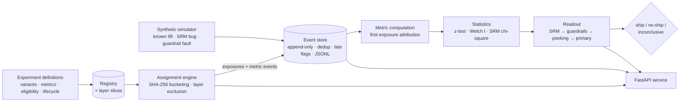

# Experimentation Platform

 

An enterprise-grade reference implementation of an **A/B experimentation
platform**: validated experiment definitions with a lifecycle state
machine, **deterministic hash-based assignment** with
**mutual-exclusion layers**, an append-only **exposure/event store**,
**statistics in pure stdlib** (two-proportion z-test, Welch's t-test,
SRM chi-square — no scipy), an **O'Brien–Fleming-style peeking guard**,
**decision readouts** (ship / no-ship / inconclusive), and a
deterministic **synthetic traffic simulator** with injectable faults.
Served over FastAPI and a CLI.

All data is **synthetic** (invented units and outcomes generated
deterministically in code from known ground truth) and all code is
original — a clean-room build suitable for studying the architecture
without any real-world system behind it.

## The problem

Running experiments is easy. Running experiments whose *results you
can trust* is not. The failure modes are quiet:

1. **Unstable assignment.** If bucketing depends on mutable state, a
   unit can drift between variants mid-experiment and contaminate
   both arms.
2. **Overlapping experiments.** Two tests touching the same surface
   (two pricing tests, say) interact, and neither result means what
   it claims.
3. **Broken logging that looks like signal.** A dropped-exposure bug
   skews the split; without a sample-ratio-mismatch (SRM) check, the
   team ships on numbers produced by a bug.
4. **Peeking.** Checking results daily and stopping "when it's
   significant" inflates false positives far beyond the nominal
   alpha — the most common way experiment programs fool themselves.
5. **Winning the metric, breaking the product.** The primary metric
   improves while errors spike. Without guardrails that can *veto*,
   the ship decision is a coin flip dressed as analysis.

This platform is structured so each failure mode is handled by a
specific, tested mechanism rather than by analyst vigilance.

## Architecture



Full design notes: [docs/architecture.md](docs/architecture.md).

## Quickstart

Requires Python 3.11+.

```bash
pip install -r requirements.txt
pip install -e .

# End-to-end demo: three scenarios, three different readouts
python examples/run_demo.py
# equivalently: experimentation-platform demo
```

The demo simulates deterministic traffic against known ground truth:

| Scenario | Injected truth | Readout |
|---|---|---|
| Real lift, clean logging | +50% relative lift | **SHIP** |
| Dropped control exposures | SRM logging bug | **INCONCLUSIVE** (invalid) |
| Lift + payment-error regression | guardrail fault | **NO-SHIP** (veto) |

Use it as a library:

```python
from experimentation_platform import (
    AssignmentEngine, EventStore, ExperimentRegistry,
    build_readout, compute_all_metrics, srm_check,
)
from experimentation_platform.simulator import (
    build_demo_experiment, simulate_traffic,
)
from experimentation_platform.stats import required_n_proportions

experiment = build_demo_experiment()          # checkout-flow test
registry = ExperimentRegistry()
registry.register(experiment)

engine = AssignmentEngine()
variant = engine.assign(experiment, "unit-123", {"country": "US"})

sim = simulate_traffic(experiment, n_units=6000, true_lift=0.5)
store = EventStore()
store.extend(sim.events)

results = compute_all_metrics(experiment, store)
primary = results[experiment.primary_metric.name]
srm = srm_check(
    [primary.per_variant[v.name].n_exposed for v in experiment.variants],
    [v.weight for v in experiment.variants],
)
readout = build_readout(
    experiment.id, primary,
    {m.name: results[m.name] for m in experiment.guardrail_metrics},
    srm, n_required=required_n_proportions(0.10, 0.02),
)
print(readout.decision)   # Decision.SHIP
```

Plan a sample size:

```bash
experimentation-platform plan --kind conversion --baseline 0.10 --mde 0.02
# required per-variant sample size: 3839
```

Run the serving API:

```bash
experimentation-platform serve --port 8000
# GET  /health
# POST /experiments                          create (validated)
# GET  /experiments[/{id}]                   list / fetch
# POST /experiments/{id}/transition          {"target": "running"}
# POST /experiments/{id}/assign              {"unit_id": "...", "attributes": {...}}
# POST /experiments/{id}/events              ingest one event (dedup-aware)
# GET  /experiments/{id}/results             per-variant metrics + tests
# GET  /experiments/{id}/readout             decision report
```

Docker:

```bash
docker build -t experimentation-platform .
docker run -p 8000:8000 experimentation-platform
```

## Key design decisions & trade-offs

- **Hash bucketing, no assignment state.** A unit's variant is a pure
  function of `salt:unit_id` (SHA-256 onto [0, 1), then cumulative
  weights). It is stable across processes and restarts, needs no
  database in the decision path, and is reproducible in any language
  that can hash the same string. The price: changing weights
  mid-experiment re-buckets everyone — which is why weights are part
  of the frozen definition and lifecycle changes are explicit.
- **Layers allocate slices, not locks.** Experiments in a
  mutual-exclusion layer own disjoint slices of one shared hash
  space, handed out first-fit by the registry, which rejects any
  registration past 100%. Overlap is impossible by construction; no
  runtime coordination is needed. The price: a layer's capacity is
  fragmented by concluded experiments (slices are never recycled, so
  historical assignments stay interpretable).
- **First-exposure attribution, stated once.** A unit's outcomes
  belong to its first exposure's variant; unexposed units never
  count. Duplicate exposures and duplicate event ids are kept,
  counted, and excluded — visible in the log, invisible to metrics.
- **Late events are flagged, not silently absorbed.** Events arriving
  more than a window behind an experiment's watermark are stored but
  excluded from metrics unless the caller opts in. A backfill is a
  decision, not an accident.
- **Pure-stdlib statistics.** The z-test, Welch's t-test (via the
  regularized incomplete beta), and the SRM chi-square (via the
  incomplete gamma) are implemented from `math` primitives and pinned
  against hand-computed / scipy-verified values. Results reproduce
  in any environment, including ones where scipy cannot be installed.
- **The peeking guard is a guard, not a sequential test.** At
  information fraction *t*, a naively significant result must also
  clear the O'Brien–Fleming-style boundary `z / sqrt(t)` to ship;
  otherwise the readout is INCONCLUSIVE with "keep running". This is
  documented honestly in `readout.py`: it blocks the classic
  stop-when-significant failure, but it is not a mixture SPRT or a
  full alpha-spending analysis, and it does not pretend to be.
- **Readout order is a policy.** SRM → guardrails → peeking →
  primary. A broken split invalidates everything; a guardrail breach
  vetoes a win; an early read defers; only then does the primary
  metric decide. The order is the governance, encoded.

## What it demonstrates

- Experiment definitions as validated contracts: variant weights,
  exactly one control and one primary metric, eligibility rules, and
  a lifecycle (draft → running → paused → concluded) that rejects
  illegal transitions.
- Deterministic assignment proven stable and uniform by test, with
  unequal weights and layer exclusion proven non-overlapping.
- Exposure logging with deduplication, duplicate-exposure handling,
  late-event flagging, and JSONL persistence round-trips.
- Statistics with known-answer tests: z = 2.1027 for 100/1000 vs
  130/1000, Welch t = 3.6742 (df 4) for [1,2,3] vs [4,5,6],
  SRM chi² = 40.0 for a 600/400 split, and closed-form sample sizes
  (3,839 per variant for baseline 0.10, MDE 0.02, power 0.8).
- A simulator that injects each fault the platform defends against,
  so every readout path is exercised end-to-end in the demo and the
  test suite.

## Testing

```bash
PYTHONPATH=src python -m pytest -q   # or: make test
```

68 tests cover assignment stability/uniformity/weights, layer
exclusion and overflow, lifecycle validation, eligibility operators,
event dedup/late/JSONL behavior, metric computation against a
hand-built dataset, the statistics against hand-computed values,
readout logic for every decision path, simulator determinism and
fault injection, and the HTTP API end-to-end.

CI: [docs/github-actions-ci.yml](docs/github-actions-ci.yml) is a
ready-to-use GitHub Actions workflow (move it to
`.github/workflows/ci.yml` to activate).

## Limitations

- In-memory registry and event store; production deployments put the
  registry in a config service and events behind a stream processor —
  the semantics here are the contract those systems must keep.
- The peeking guard is an O'Brien–Fleming-style heuristic (see
  above), not a full sequential-testing framework.
- Two-sided tests only; one-sided readouts are a policy choice this
  reference deliberately does not make for you.
- Continuous metrics use the first per-unit event value; metrics that
  need per-unit aggregation (sum of purchases, max session length)
  should be pre-aggregated by the producer.
- No variance reduction (CUPED), stratification, or cluster
  randomization — documented extensions, not implemented.

## License

MIT — see [LICENSE](LICENSE).
