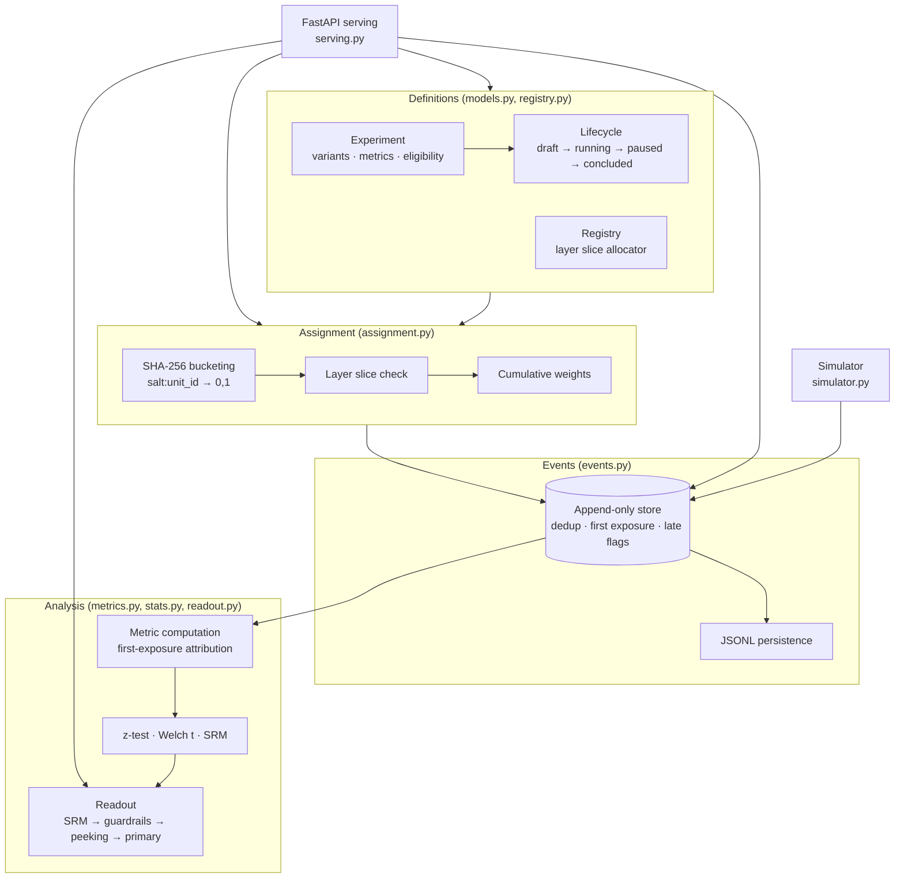

# Architecture — Experimentation Platform

## Problem framing

An experimentation platform makes one promise: *the decision at the
end of an experiment is warranted by the data collected during it.*
That promise decomposes into guarantees at each stage:

- **Definition:** the experiment that ran is the experiment that was
  designed — weights, metrics, and eligibility cannot drift silently.
- **Assignment:** every unit's variant is stable, unbiased, and
  exclusive where exclusivity is required.
- **Logging:** what analysis sees is what actually happened — once,
  attributed to the right variant, with late data visible as late.
- **Analysis:** the statistics are the textbook statistics, the split
  itself is validated (SRM), guardrails can veto, and early reads are
  discounted.
- **Decision:** the readout combines those checks in a fixed,
  auditable order and states its reasons.

## Components

### Definitions (`models.py`, `registry.py`)

Experiments are validated at construction: at least two variants,
weights summing to 1, exactly one control, unique metric names,
exactly one primary metric, guardrail tolerance non-negative.
Eligibility rules are typed predicates over unit attributes
(`eq/ne/in/not_in/gt/gte/lt/lte/exists`); a missing attribute fails
closed (not eligible), except for an explicit `exists: false` check.

The lifecycle is a transition table, not a convention:
`draft → {running, concluded}`, `running → {paused, concluded}`,
`paused → {running, concluded}`, `concluded → {}`. Anything else
raises `InvalidTransitionError`.

The registry adds the one cross-experiment invariant: layer slices.
Each experiment joining a layer receives
`[layer_start, layer_start + allocation_fraction)` starting where the
previous experiment in that layer ended. A registration that would
push the layer past 1.0 is rejected. Slices are never recycled.

### Assignment (`assignment.py`)

`unit_interval(unit_id, salt)` hashes `f"{salt}:{unit_id}"` with
SHA-256 and maps the first eight bytes onto [0, 1). Assignment:

1. Eligibility: all rules must pass, else the unit does not enter.
2. Layer: the unit's position in `layer:<name>` hash space must fall
   inside this experiment's slice, else it does not enter *this*
   experiment (it may belong to a sibling in the same layer).
3. Variant: the unit's position in `exp:<id>:<salt>` hash space is
   walked over cumulative variant weights.

Properties: deterministic (same inputs, same variant, forever),
stateless (nothing to store, replicate, or lose), and independent
across experiments (different salt ⇒ independent hash ⇒ independent
assignment), except where a layer deliberately couples them.

### Event store (`events.py`)

Events are immutable and append-only. Ingestion defenses:

- **Event-id deduplication.** A re-delivered `event_id` is dropped
  and counted (`duplicates_dropped`); producers may retry safely.
- **First exposure wins.** Repeated exposures for a unit are counted
  (`duplicate_exposures`) but analysis attributes the unit to its
  first exposure's variant.
- **Late flagging.** A per-experiment watermark tracks the newest
  timestamp seen. An event more than `late_window_seconds`
  (default 1 hour) behind the watermark is flagged late: stored,
  counted (`late_count`), and excluded from metric computation
  unless `include_late=True`.

Persistence is JSON Lines — one event per line, timestamps in
ISO-8601 — and a save/load round-trip reproduces the store exactly
(proven by test).

### Metric computation (`metrics.py`)

Attribution: a metric event counts only if its unit was exposed, and
it counts toward the unit's first-exposure variant.

- **Conversion:** converted = exposed units with ≥ 1 event named
  after the metric. Comparison: pooled two-proportion z-test;
  confidence interval from the unpooled standard error.
- **Continuous:** each unit contributes its first metric event's
  value. Comparison: Welch's t-test with Welch–Satterthwaite
  degrees of freedom and a t-based interval.

### Statistics (`stats.py`)

Pure stdlib, by design (see README trade-offs):

- Normal CDF from `math.erf`; quantiles by bisection (200 iterations,
  exact to float precision at the tolerances tested).
- Student's t CDF via the regularized incomplete beta function,
  evaluated with Lentz's continued fraction.
- Chi-square survival function via the regularized upper incomplete
  gamma, series expansion below `a + 1` and continued fraction above.
- SRM: chi-square goodness-of-fit of observed exposure counts
  against planned weights, strict default threshold p < 0.001.
- Planning: closed-form per-variant sample sizes for proportions,
  `n = (z_{1-α/2} + z_power)² (p₁(1−p₁) + p₂(1−p₂)) / Δ²`, and for
  continuous outcomes, `n = 2 (z_{1-α/2} + z_power)² σ² / Δ²`, plus a
  normal-approximation achieved-power estimate.

Every function is pinned in the test suite against values computed
by hand and cross-checked with scipy.

### Peeking guard (`readout.py`)

Scope, stated plainly: this is **not** a sequential test. There is
no alpha-spending *inference* and no always-valid p-value here.
The guard is O'Brien–Fleming in spirit:

- Information fraction `t = n_now / n_planned` (totals across arms,
  capped at 1).
- OBF critical value `z* = z_{1−α/2} / sqrt(t)`.
- If the primary result is naively significant (p < α) but
  `|z| < z*` and the read is early (`t < 1`) or repeated
  (`looks > 1`), the readout flags `peeking_risk` and returns
  INCONCLUSIVE with the boundary and the recommendation to keep
  running.

At `t = 1` with a single look the boundary equals the ordinary
critical value, so a planned-end analysis is unaffected. What this
buys: the "check every day, stop when green" workflow cannot produce
a SHIP. What it does not buy: valid inference under arbitrary
continuous monitoring — a team that needs that should implement a
mixture SPRT or a proper group-sequential design and replace this
guard, keeping the readout's interface.

### Readout (`readout.py`)

Decision order is fixed policy:

1. **SRM failed → INCONCLUSIVE.** The split contradicts the design;
   nothing downstream is trustworthy.
2. **Any guardrail breach → NO-SHIP.** Breach = effect beyond the
   metric's tolerance in the bad direction *and* statistically
   significant. Significance is required so noise alone cannot veto,
   and tolerance is required so trivial-but-significant degradations
   at huge n cannot veto either; both knobs are per-metric policy.
3. **Peeking risk → INCONCLUSIVE** ("keep running").
4. **Primary significant** → SHIP if in the good direction,
   NO-SHIP if against it.
5. **Otherwise → INCONCLUSIVE**, with the observed vs required
   per-variant sample sizes stated when a plan exists.

Every readout carries its reasons as strings; the API returns them
verbatim. A decision that cannot explain itself does not ship.

### Simulator (`simulator.py`)

Deterministic (`random.Random(seed)`) traffic over the demo
experiment with three fault/lift knobs: `true_lift` (relative, on
the treatment arm), `inject_srm` (drops a fraction of control
exposures — the logging bug SRM exists to catch), and
`guardrail_regression` (absolute degradation on guardrail metrics).
Because ground truth is known, the demo and the readout tests assert
*decisions*, not just numbers.

### Serving (`serving.py`)

FastAPI over the same objects: experiment CRUD-lite (create/list/get,
transition), assignment, single-event ingestion with dedup reporting,
results, and readout. Validation errors map to 422, missing
experiments to 404. No logic lives in the API layer.

## Design trade-offs

- **In-memory state.** The registry and store semantics — validation,
  attribution, dedup, lateness — are the substance; storage engines
  are replaceable behind the same interfaces, exactly as a production
  deployment would separate a config service from a stream processor.
- **Slices never recycled.** Concluded experiments keep their layer
  slice. Capacity leaks slowly; interpretability of historical
  assignments is permanent. For this reference, the second wins.
- **Two-sided tests only.** One-sided readouts encode a business
  decision (which errors matter) that a reference implementation
  should surface, not hide.
- **First-value continuous metrics.** Per-unit pre-aggregation keeps
  the attribution rule single and testable; richer per-unit reducers
  belong upstream, where the metric's owner can define them.
